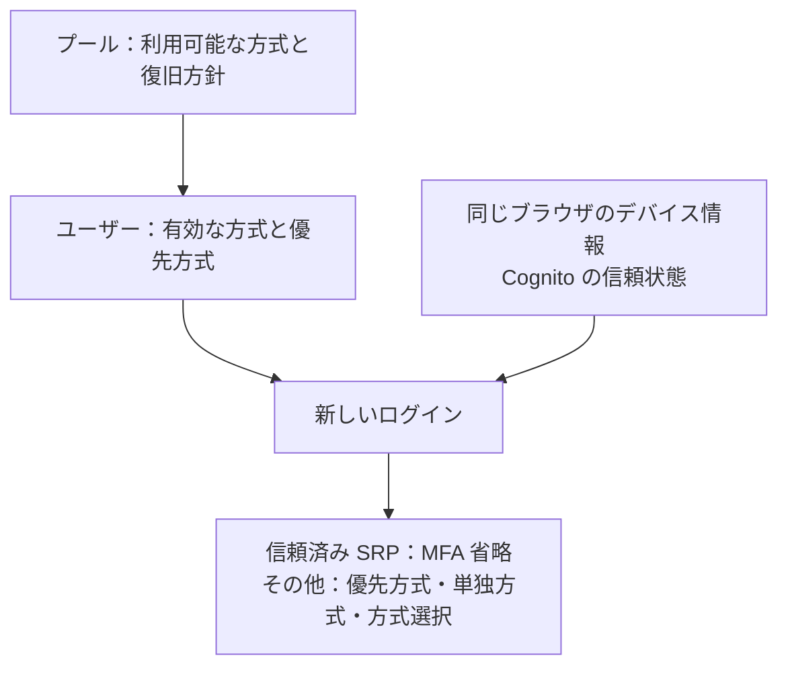

# MFA 方式とパスワード復旧

MFA はパスワード認証に追加する確認です。方式の利用条件はプール全体、方式の有効状態と優先はユーザーごとに管理します。

## 目次

- [プール全体とユーザー個別の設定](#プール全体とユーザー個別の設定)
- [ログイン時に使う方式](#ログイン時に使う方式)
- [パスワード復旧との組み合わせ](#パスワード復旧との組み合わせ)
- [SES サンドボックスの制約](#ses-サンドボックスの制約)
- [SMS サンドボックスの制約](#sms-サンドボックスの制約)

## プール全体とユーザー個別の設定

| 層 | 設定 | 今回の構成 |
| --- | --- | --- |
| プール | 利用可能な方式、必須・任意、送信と復旧 | OPTIONAL、TOTP・メール・SMS、SES と SNS、管理者復旧 |
| ユーザー | 各方式の有効状態、優先方式、email・phone_number 属性 | MFA 設定画面で変更 |
| デバイス | Cognito の信頼状態とブラウザの認証情報 | SRP の MFA 省略に使用 |

プールにメール MFA を追加しても全ユーザーのメール MFA は自動的に有効になりません。メール MFA のコードは本人の `email` 属性へ送ります。このアプリでは `email_verified=true` を確認してから有効化します。SMS の送信先は `phone_number` 属性です。このアプリは `phone_number_verified=true` も確認してから有効化します。TOTP の登録、メール・SMS の有効化、デバイスの信頼は独立して管理します。

## ログイン時に使う方式

| ユーザーの有効方式 | 優先設定 | 新しい SRP ログイン |
| --- | --- | --- |
| TOTP のみ | TOTP | 認証アプリのコード |
| メールのみ | メール | メールのコード |
| SMS のみ | SMS | SMS のコード |
| 2方式以上 | 有効な方式のいずれか | 優先した方式のコード |
| 2方式以上 | 優先なし | Cognito が返す有効方式から選択 |
| なし | なし | OPTIONAL では MFA なし |

信頼済みブラウザの SRP ログインでは方式にかかわらず MFA の省略を確認します。方式変更は信頼状態を解除しません。Managed Login はデバイス記憶による省略を利用しません。方式選択の表示は Cognito の認証ステップに従います。

## パスワード復旧との組み合わせ

| プールの復旧方針 | メール MFA | 自己パスワード復旧 |
| --- | --- | --- |
| メールのみ | 利用不可 | 確認済みメールへ配送 |
| メールと電話を併用 | 利用可能な組み合わせあり | MFA 配送先と別の確認済み属性が必要 |
| 管理者のみ（今回） | 利用可能 | 全ユーザーで利用不可 |

メール MFA とメール復旧は同じユーザーの同じ配送先を併用できません。優先設定を外すだけでこの制約が解消するとは扱わず、プールの復旧方針とユーザーの有効方式・確認済み属性の両方を確認します。今回の `admin_only` は TOTP のみのユーザーにも適用されます。管理者のパスワード再設定とセッション失効は別操作です。

[AWS：パスワードと復旧](https://docs.aws.amazon.com/cognito/latest/developerguide/managing-users-passwords.html)、[AWS：MFA](https://docs.aws.amazon.com/cognito/latest/developerguide/user-pool-settings-mfa.html)。

## SES サンドボックスの制約

送信元と受信先を東京リージョンの SES で個別に所有確認します。Gmail エイリアスも別アドレスとして確認し、同じ受信箱への配送であることを把握します。SMTP サーバーや Gmail のパスワードは不要です。

SES の宛先制限は MFA だけでなく登録確認・属性確認・招待メールにも及びます。未確認宛先の一般ユーザーには使えません。送信数・速度の制限があり、少数の手動検証に限定します。配送確認に失敗した場合は Cognito を変更せず、送信元を見直します。

実装と手順は [メール MFA POC](./poc/010-email-mfa-sandbox.md) を参照してください。

## SMS サンドボックスの制約

東京リージョンのサンドボックスで確認済みの携帯番号だけに送信します。サンドボックスの確認と Cognito の `phone_number_verified` は別の確認です。番号確認・属性確認・MFA の SMS は送信ごとに課金されるため、少数の手動確認に限定します。

SMS MFA と SMS による自己復旧も、同じ配送先を併用できません。現在の管理者復旧では全方式のユーザーで自己復旧を使いません。手順と検証範囲は [SMS MFA POC](./poc/011-sms-mfa-sandbox.md) を参照してください。
