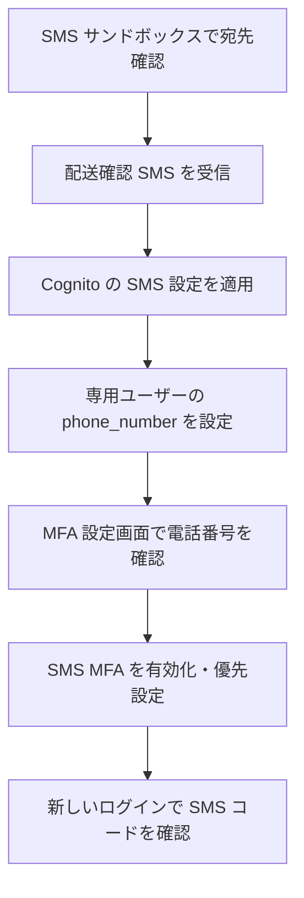

# SMS サンドボックスの MFA

東京リージョンで、日本の携帯番号1件に SMS MFA を追加する構成です。TOTP・メール・Managed Login・SRP・信頼するデバイスを維持します。

## 目次

- [構成と確認する動作](#構成と確認する動作)
- [電話番号の2つの確認](#電話番号の2つの確認)
- [SMS の配送準備](#sms-の配送準備)
- [Cognito の設定と専用ユーザー](#cognito-の設定と専用ユーザー)
- [画面での確認](#画面での確認)
- [検証結果と制約](#検証結果と制約)

## 構成と確認する動作

| 検証テーマ | 設定・確認内容 |
| --- | --- |
| SMS 配送 | サンドボックスの番号確認、短い配送確認 SMS の受信 |
| SMS 単独の MFA | SMS のみ有効にし、パスワードの後にコード入力 |
| 3方式の併用 | TOTP・メール・SMS の独立した有効化・無効化 |
| 優先方式と選択 | 認証アプリ優先・メール優先・SMS 優先・ログイン時に選択 |
| 信頼するデバイス | SRP の信頼済みブラウザでは省略、解除後は再要求 |
| 異常系 | 誤コードの再入力、認証セッション期限切れからの再ログイン |

SMS 配送は `ap-northeast-1` の SNS 経由です。SNS トピックや購読は作成せず、Cognito が IAM ロールを引き受けて電話番号へ直接送信します。サンドボックス解除・専用番号の購入・送信上限の引き上げは含めません。復旧は既存の `admin_only` を維持し、自己パスワード復旧は使えません。

## 電話番号の2つの確認

| 保存先 | 確認の意味 | 操作 |
| --- | --- | --- |
| SMS サンドボックス | AWS アカウントから送信できる宛先 | 準備スクリプトで登録し、SMS のコードを確認 |
| Cognito ユーザー | サインイン中のユーザーが持つ電話番号 | MFA 設定画面で確認コードを送信・検証 |



サンドボックス確認だけで Cognito の `phone_number_verified` を確認済みにしません。このアプリは番号属性と確認済み状態を読み、有効化前に確認を要求します。

## SMS の配送準備

Git 管理外のルート `.env` に `MFA_SMS_TO` を設定します。日本の携帯番号の先頭の0を除き、`+81` を付けた国際形式を使います。電話番号・確認コードを `VITE_` 変数には入れません。

```bash
node scripts/sms-mfa.mjs status
node scripts/sms-mfa.mjs register
```

既に登録済みの番号には確認コードを自動再送しません。受信した6桁を `.env` の `MFA_SMS_VERIFY_CODE` に設定して確認します。

```bash
node scripts/sms-mfa.mjs verify
node scripts/sms-mfa.mjs delivery
```

`delivery` は短い英語の確認 SMS を1通だけ送ります。送信試行を Git 管理外の `.sms-mfa-delivery.json` に記録し、失敗・応答不明時も自動再送しません。受信確認後だけ次を実行します。

```bash
node scripts/sms-mfa.mjs confirm-delivery
```

確認後は `MFA_SMS_VERIFY_CODE` を削除します。SNS サンドボックスの宛先確認コードと、Cognito がサインイン時に送るコードは別のものです。電話番号の登録・配送の AWS 入力は権限を限定した一時ファイルで渡し、番号やコードをログ・コマンド引数に出しません。

## Cognito の設定と専用ユーザー

既存のメール MFA 設定に SMS 設定例を重ねて plan を確認します。WAF は既定の無効を維持します。

```bash
terraform -chdir=terraform/app plan \
  -var-file=examples/mfa-email.tfvars.example \
  -var-file=examples/mfa-sms.tfvars.example
# 差分を確認してから適用
terraform -chdir=terraform/app apply \
  -var-file=examples/mfa-email.tfvars.example \
  -var-file=examples/mfa-sms.tfvars.example
```

追加対象は SMS 用 IAM ロール・インラインポリシー・External ID と、User Pool の SMS 設定です。電話番号は Terraform に渡しません。送信権限・信頼ポリシーの判断は [ADR 0015 草案](../adr/0015-sms-mfa-sandbox.md) を参照してください。

専用ユーザーは既存のメール MFA ユーザーを使えます。ルート `.env` の `MFA_EMAIL_USER_POOL_ID` と `MFA_EMAIL_TO` を使用し、別ユーザーを使う場合だけ `MFA_SMS_USER_EMAIL` を指定します。

```bash
node scripts/sms-mfa.mjs user
```

配送確認・プール設定を確認してから、番号のない専用ユーザーに `phone_number` と `phone_number_verified=false` を設定します。既存の別番号やパスワードは上書きしません。同じ番号なら確認状態を維持します。

フロントエンドの `VITE_SMS_MFA_ENABLED` は設定適用後に `true` にします。デプロイスクリプトは適用済み Terraform state から設定を読み取ります。フラグだけでは AWS の設定は変わりません。

## 画面での確認

MFA 設定画面の「SMS MFA」で電話番号と確認状態を確認し、番号確認後に SMS を有効化します。未登録の場合は既存のプロフィール編集で設定できますが、送信先はサンドボックスで確認した番号に限定してください。

「ログイン時の方式」は有効な方式だけを表示します。1方式ならその方式を使用し、2方式以上なら優先方式か「ログイン時に選択」を設定できます。優先方式を無効にして2方式以上残る場合は選択に戻し、1方式だけ残る場合はその方式を優先にします。無効化で TOTP の登録やデバイスの信頼は削除しません。

SRP の SMS 入力画面は Cognito が返した伏せ字の配送先を表示します。誤コードは再入力でき、認証セッション期限切れはログインから再開します。ログインコードの独立した再送ボタンは追加しません。Managed Login の画面は Cognito に任せます。

## 検証結果と制約

SMS サンドボックスで日本の携帯番号1件の確認と、配送確認 SMS 1通の受信を確認しました。確認時の送信上限設定は月額 $1 です。上限はアカウント・リージョンの設定であり、サンドボックスが無料になる意味ではありません。

ローカル検証は frontend 単体テスト53件、E2E 補助テスト29件、Terraform 設定テスト23件、モック E2E 7件が成功しました。Oxfmt・oxlint・ビルド・Terraform validate も成功しました。

単体テストで3方式の有効状態・優先設定・電話番号確認・SMS 認証ステップ・誤コードと期限切れの扱いを検証します。モック E2E は電話番号確認、4つの優先設定、3方式選択、SMS の誤コード再試行、信頼済み端末の省略と解除後の再要求を検証します。キャプチャはモックのみです。

実環境の plan は SMS 用の3リソース作成と User Pool の SMS 設定更新のみを確認しました。Cognito への適用、公開 frontend のデプロイ、実 Cognito での SMS サインインと全方式の組み合わせ確認は未実施です。実電話番号・コード・トークンをテスト成果物に保存しません。

参考：[AWS：Cognito の SMS 設定](https://docs.aws.amazon.com/cognito/latest/developerguide/user-pool-sms-settings.html)、[SNS サンドボックス](https://docs.aws.amazon.com/sns/latest/dg/sns-sms-sandbox.html)。
