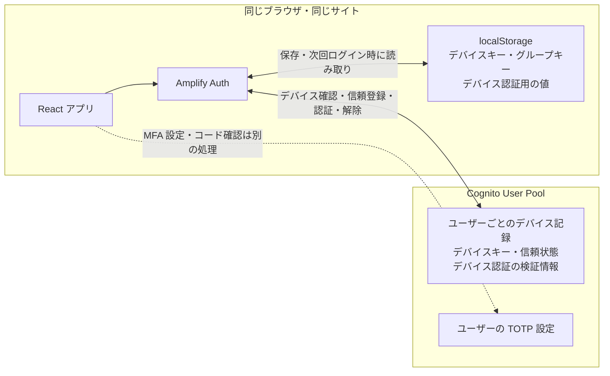
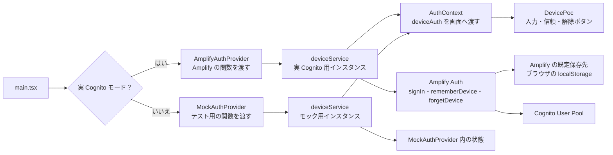
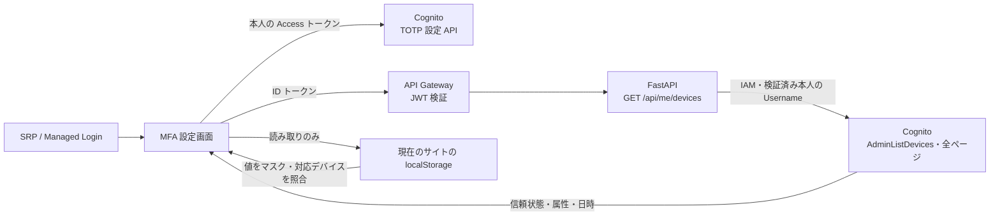

# 信頼するデバイスの保存先と実装

この POC では、Cognito がユーザーごとのデバイス記録を持ち、ブラウザの Amplify Auth が次回そのデバイスを示す情報を保持する。どこに何が残るかと、アプリから保存処理までの呼び出しを整理する。デバイス記憶の検証記録は [POC 008](./poc/008-trusted-device.md)、情報表示の検証と操作手順は [POC 009](./poc/009-device-diagnostics.md) を参照する。

## 目次

- [保存先と保持する情報](#保存先と保持する情報)
  - [localStorage の各項目](#localstorage-の各項目)
  - [保存項目の更新と削除](#保存項目の更新と削除)
- [アプリから保存処理まで](#アプリから保存処理まで)
- [操作ごとの状態変化](#操作ごとの状態変化)
- [ログイン後のデバイス一覧](#ログイン後のデバイス一覧)
- [表示の判定と確認方法](#表示の判定と確認方法)
  - [Cognito の信頼状態](#cognito-の信頼状態)
  - [ブラウザの保存情報とマスク](#ブラウザの保存情報とマスク)
- [関連コードと仕様](#関連コードと仕様)

## 保存先と保持する情報



| 保存先 | 保持するもの | 役割 |
| --- | --- | --- |
| Cognito | ユーザーに紐づくデバイスキー、信頼状態、デバイス認証の検証情報 | そのデバイスを信頼するかを判断する |
| ブラウザの `localStorage` | Amplify が管理するデバイスキー、デバイスグループキー、デバイス認証用の値 | 次回ログインで同じデバイスだと示す |

ここでの「同じデバイス」は、物理的な PC そのものではなく、**同じサイトの保存情報を持つブラウザ環境**を指す。別のブラウザ・プロファイル・シークレットウィンドウや、サイトデータを消した後のブラウザは、元の保存情報を使えない。Cognito 側のデバイス記録は、ブラウザのデータを消しただけでは削除されない。

デバイス認証用の値は TOTP シークレットとは別物。認証アプリが保持する TOTP シークレットを、信頼するデバイスのために `localStorage` に保存する実装ではない。

### localStorage の各項目

このプロジェクトで利用する Amplify Auth は、ログイン・トークン更新・デバイス認証に必要な情報を、既定の保存先である localStorage に保存する。以下は利用中の `TokenStore.ts` の実装に基づく項目であり、認証経路や設定によって存在する項目は異なる。ライブラリ更新時には保存形式が変わる可能性がある。

通常のキーは次の構造を持つ。`LastAuthUser` はユーザー識別子を含まず、アプリクライアント単位で保存する。

```text
CognitoIdentityServiceProvider.<アプリクライアントID>.<ユーザー識別子>.<項目名>
CognitoIdentityServiceProvider.<アプリクライアントID>.LastAuthUser
```

| 分類 | 項目名 | 役割 |
| --- | --- | --- |
| デバイス | `deviceKey` | Cognito に登録された、このブラウザのデバイスを識別するキー |
| デバイス | `deviceGroupKey` | デバイス認証で使うグループの識別情報 |
| デバイス | `randomPasswordKey` | デバイス認証に使う秘密情報。ユーザーのログインパスワードや TOTP シークレットとは別 |
| トークン | `accessToken` | Cognito の本人用 API などを利用するためのトークン |
| トークン | `idToken` | ユーザーの識別情報・属性を持つトークン。このアプリではバックエンドへの認証にも使用 |
| トークン | `refreshToken` | 新しい Access／ID トークンを取得するためのトークン |
| その他 | `clockDrift` | ブラウザと認証サーバーの時刻差。トークン期限の判定に使う補正値 |
| その他 | `signInDetails` | ログイン時の識別子や認証方式などの情報 |
| その他 | `LastAuthUser` | 最後にログインしたユーザー。どのユーザーの保存情報を読むか判断するために使用 |

この表は localStorage の全項目を網羅するものではない。OAuth の経路では、Amplify が追加の状態管理用の情報を保存する場合もある。

`loglevel` は名前からログ出力レベルの設定と考えられるが、このプロジェクトのアプリと利用中の Amplify のコードでは生成元を特定できていない。上の9項目と異なり、Amplify が登録する項目としては扱わない。

### 保存項目の更新と削除

同じアプリクライアント・同じユーザーでは、トークンなどは基本的に同じキーへ上書きされる。ログインのたびに履歴として項目を追加する仕組みではない。別ユーザーや別のアプリクライアントではキーが異なるため、以前の項目が残る場合がある。診断画面の読み取り自体は保存項目を追加しない。

サインアウト時、Amplify はトークン・`clockDrift`・`signInDetails`・`LastAuthUser` などを削除するが、デバイス認証情報は次回のために保持する。デバイス情報の削除は `forgetDevice()` による別の操作である。

ブラウザ側の localStorage を削除しても、Cognito のデバイス記録・TOTP 設定や認証アプリの登録は削除されない。ブラウザは元のデバイス認証情報を提示できなくなるが、発行済みトークンを Cognito 側で失効させる操作にはならない。

## アプリから保存処理まで



`main.tsx` は起動時にどちらか一方の Provider を選ぶ。どちらも同じ `createDeviceService` から別のインスタンスを作る。`deviceService.ts` は `localStorage` を直接読み書きしない。実 Cognito 経路では、`AmplifyAuthProvider.tsx` が Amplify Auth の関数を渡す。画面は `AuthContext` の `deviceAuth` を呼ぶので、画面にも保存処理の分岐はない。

実 Cognito の経路で初めてログインに成功すると、Amplify は Cognito から新しいデバイスキーを受け取り、デバイスを確認登録する。この時点で Amplify は、次回のデバイス認証に使う情報を既定の保存先へ書き込む。Amplify Auth の現在のブラウザ向け既定保存先は `localStorage`。この POC は保存先を変更していない。

「このブラウザを信頼する」を押すと、`deviceService` の `rememberCurrentDevice()` が、渡された Amplify の `rememberDevice()` を呼ぶ。Amplify は保存済みのデバイスキーを読み、Cognito のデバイス状態を `remembered` に更新する。**ブラウザへのデバイス情報の保存はログイン時、信頼状態の更新はボタンを押した時**に行う。

モック経路では `MockAuthProvider` の関数を渡し、ブラウザ内のテスト用状態を変える。Cognito への通信も、Amplify による `localStorage` へのデバイス情報保存も行わない。

## 操作ごとの状態変化

| 操作 | ブラウザ側 | Cognito 側 |
| --- | --- | --- |
| 新しいブラウザで SRP・TOTP ログイン | Amplify がデバイス認証用の情報を保存 | 新しいデバイスを確認登録。信頼は別途選択 |
| 「このブラウザを信頼する」 | 保存済み情報を Amplify が読み取る | デバイスを `remembered` に更新 |
| サインアウト | 認証トークンを消す。デバイス情報は次回のため保持 | デバイスの信頼状態は継続 |
| 同じブラウザで再ログイン | 保存済み情報を使ってデバイス認証 | 信頼済みデバイスと確認できれば TOTP を省略 |
| 「この端末の信頼を解除」 | Amplify が現在のデバイス情報を消す | `ForgetDevice` でデバイス記録を削除 |
| ブラウザのサイトデータを削除 | デバイス情報も失う | 記録は残るが、元の情報を提示できない |

信頼解除は、すでに発行されたトークンの失効操作ではない。トークンの期限とデバイスの信頼状態は別々に扱う。

## ログイン後のデバイス一覧

MFA 設定画面を、TOTP・Cognito のデバイス・ブラウザの保存情報の3グループに分ける。SRP と Managed Login の両方から同じ画面を開ける。

| グループ | 整形表示 | 詳細表示 |
| --- | --- | --- |
| TOTP | 有効・無効、優先方式、登録と設定操作 | 本人用 API を Amplify が返す形式の MFA 設定 |
| Cognito のデバイス | 短縮したデバイス名、信頼状態、登録・更新・最終認証日時 | `AdminListDevices` の各デバイスの全フィールド |
| ブラウザの保存情報 | デバイス・トークン・その他への分類、保存キーと Cognito の対応デバイス | 現在のサイトの localStorage の全項目、JWT のペイロード |



バックエンドは対象ユーザーをリクエスト引数から受け取らない。Lambda Web Adapter が上書きする `x-amzn-request-context` の、API Gateway JWT Authorizer による検証済み claims から本人の Username を決定する。Lambda 外で実 Cognito モードを使う場合は、このヘッダーだけを信用せず拒否する。デバイス参照の IAM 権限は対象 User Pool の `AdminListDevices` に限定し、全ページを取得する。応答は `Cache-Control: no-store` とし、取得した属性をログへ記録しない。

## 表示の判定と確認方法

### Cognito の信頼状態

`dev:device_remembered_status` の `remembered` / `not_remembered` を「信頼済み」/「未信頼」と表示する。属性がない場合は「取得できません」と表示する。一覧への存在や `device_status = valid` から信頼状態を推測しない。本人用の `ListDevices` / `GetDevice` では信頼状態を取得できなかったが、管理者用の `AdminListDevices` で `remembered` の取得を確認した。

Access トークンの `device_key` と一覧のキーが一致する場合に「このブラウザ」を表示する。Managed Login ではトークンにキーがなく、識別できない場合もある。localStorage の `deviceKey` が一覧と一致する場合は、保存情報のグループで対応デバイスを表示する。保存情報が一致することと、そのログインでデバイス認証を使ったことは区別する。

### ブラウザの保存情報とマスク

「localStorage を読み込む」で現在のサイトの全項目を読み取り、デバイス認証用のキー・秘密情報、トークン、その他に分類する。保存情報は変更・削除しない。他サイト・別ブラウザ・HttpOnly Cookie は読み取らない。Cognito との照合が失敗しても保存情報自体は確認できる。

raw データと保存値は初期状態でマスクする。各詳細を開き「マスクを解除して表示」を押した場合だけ表示し、詳細を閉じる・再読み込み・画面を離れると再び隠す。JWT ペイロードも同じ操作で表示するが、デコードは署名・有効性の検証ではない。リフレッシュトークンは通常 JWT ではないためペイロード表示の対象にならない。

取得済みの TOTP シークレットを Cognito から読み出す API はない。表示対象は公開 API と localStorage で読み取れる情報に限る。秘密情報・トークン・デバイスキーをログ、キャプチャ、公開文書へ残さない。

## 関連コードと仕様

| コード | この文書での役割 |
| --- | --- |
| [main.tsx](../frontend/src/main.tsx) | 実 Cognito とモックの Provider 選択 |
| [AmplifyAuthProvider.tsx](../frontend/src/auth/AmplifyAuthProvider.tsx) | Amplify Auth の関数を `deviceService` に渡す |
| [MockAuthProvider.tsx](../frontend/src/auth/MockAuthProvider.tsx) | メモリ上の状態を使う画面用モックを渡す |
| [DevicePoc.tsx](../frontend/src/components/DevicePoc.tsx) | SRP ログイン、信頼・解除の画面操作 |
| [RegisteredDevices.tsx](../frontend/src/components/RegisteredDevices.tsx) | ログイン後の MFA 設定にデバイス一覧を表示 |
| [BrowserStorage.tsx](../frontend/src/components/BrowserStorage.tsx) | localStorage の全項目と Cognito の対応デバイスを表示 |
| [devices.py](../backend/app/devices.py) | 本人限定の管理者 API、全ページ取得 |
| [diagnostics.ts](../frontend/src/auth/diagnostics.ts) | デバイス応答の変換、保存項目の分類、JWT のデコード |
| [deviceService.ts](../frontend/src/auth/deviceService.ts) | ログイン結果の解釈、API 呼び出し、状態表示の判定 |

Amplify 内部では、Cognito の `NewDeviceMetadata` を受けてデバイスを確認登録し、トークン保存処理と同じストレージ経由でデバイス情報を保持する。利用中の Amplify Auth の実装を追う場合は、インストール済みパッケージの `getNewDeviceMetadata.ts`、`TokenStore.ts`、`CognitoUserPoolsTokenProvider.ts`、`DefaultStorage.ts` を参照する。ライブラリ更新時には内部のファイル構成や保存方法が変わる可能性がある。

- [AWS: Cognito ユーザーデバイスの記憶と認証](https://docs.aws.amazon.com/cognito/latest/developerguide/amazon-cognito-user-pools-device-tracking.html)
- [AWS: ListDevices API](https://docs.aws.amazon.com/cognito-user-identity-pools/latest/APIReference/API_ListDevices.html)
- [Amplify Auth: Remember a device](https://docs.amplify.aws/gen1/react/build-a-backend/auth/remember-device/)

- [AWS: AdminListDevices API](https://docs.aws.amazon.com/cognito-user-identity-pools/latest/APIReference/API_AdminListDevices.html)
- [AWS Lambda Web Adapter のヘッダー転送実装](https://github.com/awslabs/aws-lambda-web-adapter/blob/v1.0.1/src/lib.rs)

- [ADR 0012 草案：本人限定の管理者 API による状態表示](./adr/0012-device-diagnostics-admin-api.md)
